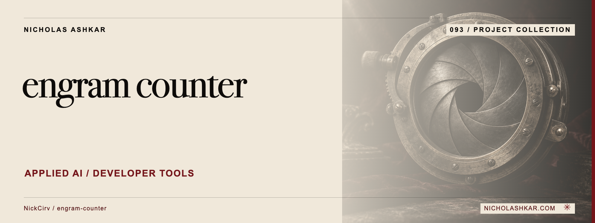

# engram-counter

[](https://github.com/NickCirv/engram-counter/actions/workflows/ci.yml)

Compare paired JSONL usage logs and produce a reproducible audit record of the supplied measurements.


## What it does

Joins baseline and active entries by query_id, aggregates token differences and workload consistency, and hashes a canonical audit block. Optional model pricing includes cache fields; strict mode also fingerprints the built files and package manifest. See the pinned [implementation](https://github.com/NickCirv/engram-counter/blob/c95e418caade2e3ee04695a3cd2e3519520a9dfa/bin/engram-counter.js).


<a id="install"></a>

## Quickstart

The package is published on npm as `engram-counter` (latest 0.2.0), so no build step is required to try it. Node >=20.18.0. Exit 0 is a clean audit, 5 a partial warning, 6 a failed audit, 2 usage and 1 internal error.

The example below was executed on 2026-10-20 against the two committed 100-query fixtures, copied into an empty directory so npx resolves the published package rather than a local checkout:

```bash
npx engram-counter@0.2.0 \
  --baseline baseline-100q.jsonl \
  --active active-100q.jsonl \
  --audit-id local-fixture-review --pretty
```

It exits 0 and reports 100 matched queries, 2,289,618 saved tokens (85.45 percent of 2,679,451 baseline tokens) and `audit_trail_hash: sha256:9d72f90ad26be5b379ef9d3c5300eac6ef4b9ae1aab857b5949b3a3cdecada67`. The hash is reproducible for this `--audit-id` and these two input files; change either and it changes.

For a procurement audit that needs to read the code it runs, build from source instead:

```bash
git clone https://github.com/NickCirv/engram-counter.git
cd engram-counter
npm ci
npm run build
npm test
node bin/engram-counter.js --baseline tests/fixtures/baseline-100q.jsonl --active tests/fixtures/active-100q.jsonl --audit-id local-fixture-review --pretty
```

Read the package scripts before enabling any lifecycle step your environment requires.

## Usage and reference

`engram-counter` are the executable names declared by the package. [Methodology](docs/methodology.md) explains what the audit digest proves and how to compare runs. [Command reference](docs/REFERENCE.md) covers source-backed options and entry points.


<a id="what-this-tool-does-not-prove-honest-disclosure"></a>

## Limits and operational notes

A SHA-256 digest makes a record comparable; it does not authenticate the log producer or prove causal savings, task equivalence or billing accuracy. Bundled pricing is a dated snapshot. The committed synthetic fixture is not a customer result.


<a id="flagship-benchmark-reproducible"></a>

<a id="reproducibility-caveat-line-endings"></a>

## Development

Verification record: on 2026-10-12, with Node v26.7.0, `npm ci && npm test` passed 365 of 365 tests and `npm run typecheck` completed cleanly. CI (`.github/workflows/ci.yml`) repeats typecheck, the full suite, the build, fixture regeneration against the committed files, and the benchmark `audit_trail_hash` check on every push to main across Node 20, 22, 24 and 26.

| Script | Declared command |
| --- | --- |
| `build` | `tsc` |
| `test` | `tsx --test tests/*.test.ts` |
| `test:coverage` | `echo 'coverage tooling will land in v0.2'` |
| `lint` | `tsc --noEmit` |
| `test:watch` | `tsx --test --watch tests/*.test.ts` |
| `typecheck` | `tsc --noEmit` |

Work from the pinned source, keep changes focused, and reproduce the affected behavior with a small fixture before proposing a change. Existing contribution and security policies remain authoritative where present.

## Research and status

[Research record](docs/RESEARCH.md) identifies the inspected revision, source evidence, documentation disposition and verification gaps. Static inspection supports the descriptions here; runtime behavior, dependency installation and current hosted services remain unverified.


<a id="license"></a>

## License and author

[License](https://github.com/NickCirv/engram-counter/blob/c95e418caade2e3ee04695a3cd2e3519520a9dfa/LICENSE)

[Nicholas Ashkar](https://nicholashkar.com) · Applied AI, systems and consulting.
